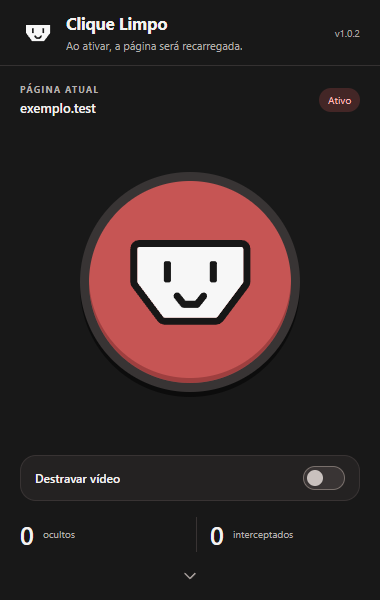
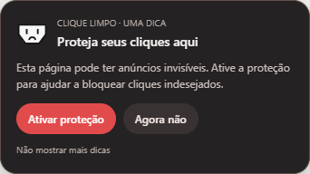

<div align="center">
  
  <h1>Clique Limpo</h1>

  [](https://github.com/emanuelz-martins/clique-limpo/stargazers)
  [](https://github.com/emanuelz-martins/clique-limpo/issues)
  [](https://github.com/emanuelz-martins/clique-limpo/network)
  [](https://github.com/emanuelz-martins/clique-limpo/watchers)
  
</div>

<div align="center">
  
</div>


## Instalação

Versão atual: **1.0.2**. As atualizações de correção avançam em `1.0.1`, `1.0.2` e assim por diante. A mudança para `1.1.0` depende da aprovação do mantenedor.

[Baixar a versão mais recente](https://github.com/emanuelz-martins/clique-limpo/releases/latest/download/Clique-Limpo.zip) · [Consultar versões](https://github.com/emanuelz-martins/clique-limpo/releases)

### Chrome e Edge

1. Baixe o arquivo `Clique-Limpo.zip` e extraia seu conteúdo em uma pasta permanente.
2. Abra `chrome://extensions` no Chrome ou `edge://extensions` no Edge.
3. Ative **Modo do desenvolvedor**.
4. Clique em **Carregar sem compactação** ou **Carregar descompactado**.
5. Selecione a pasta `clique-limpo`, que contém o arquivo `manifest.json`.
6. Recarregue as páginas abertas e fixe o ícone da extensão na barra do navegador.

Não é necessário instalar Node.js ou executar comandos para usar a extensão. Mantenha a pasta extraída no computador enquanto ela estiver instalada.

### Instalação pelas lojas

O Clique Limpo ainda não está publicado na Chrome Web Store ou no Microsoft Edge Add-ons. O botão de download do GitHub fornece o pacote para instalação manual; ele não instala a extensão automaticamente.

A instalação pelo botão da loja, com confirmação do navegador e atualizações automáticas, fica disponível após a publicação e aprovação em cada loja. As condições de distribuição dependem das políticas das plataformas.

## Como usar

Abra o site que deseja proteger e clique no ícone do Clique Limpo. No painel, pressione o botão com a carinha. Protege interações em páginas com camadas transparentes, pop-ups e redirecionamentos publicitários. A proteção é ativada manualmente na aba, sem exigir conta, assinatura ou servidor de análise. O processamento das páginas acontece no navegador.

| Ação | Comportamento |
| --- | --- |
| Ativar pela carinha ou por uma dica | Protege o site naquela aba e recarrega a página uma vez. |
| Navegar para outra página do mesmo site | Mantém a proteção, inclusive ao recarregar ou usar o histórico. |
| Abrir um link interno em nova aba | A nova aba herda a ativação. |
| Abrir uma aba separadamente | Começa desativada, mesmo que o endereço seja igual. |
| Trocar de aba | Pausa a proteção da aba anterior; voltar a ela reativa a proteção sem recarregar. |
| Sair para outro site | Apaga a ativação naquela aba. |
| Desativar manualmente | Desliga sem recarregar; exige nova ativação. |
| Reiniciar o navegador ou recarregar a extensão | Exige nova ativação. |

O site é identificado por protocolo, domínio e porta. Preferências de compatibilidade do player são salvas localmente e não ativam a proteção por conta própria.

A primeira tela destaca o botão de ativação, a opção **Destravar vídeo** e os contadores. Role para baixo, ou use a seta no rodapé, para acessar **Verificar página**, **Ocultar elemento**, **Restaurar e desativar**, GitHub, termos de uso e dicas. O aviso de recarregamento permanece no cabeçalho.

[Ver as ferramentas após rolar o painel](docs/images/painel-opcoes.png).

## Recursos

- **Camadas invisíveis:** procura elementos transparentes ou quase transparentes sobre o conteúdo, oculta os suspeitos e tenta interceptar os cliques antes dos ouvintes do site.
- **Pop-ups e redirecionamentos:** intercepta formas conhecidas de abertura publicitária de janelas, links sintéticos e tentativas de sequestro da aba.
- **Rastreamento:** bloqueia requisições para uma lista local de domínios enquanto a proteção da aba selecionada está ativa.
- **Players de vídeo:** inclui ajustes para configurações publicitárias de players compatíveis, tentativas de pausa forçada e preservação da faixa de áudio escolhida em integrações suportadas.
- **Controle manual:** permite verificar novamente a página, escolher um elemento para ocultar ou restaurar os elementos e desativar a proteção. A ocultação manual é temporária.
- **Dicas de uso:** explica a ativação na primeira abertura do painel e sugere proteção quando encontra uma camada suspeita em uma página desativada.

Se o vídeo não iniciar ou houver problemas com o idioma, experimente **Destravar vídeo** no painel. Clique no cartão ou no interruptor: a opção é salva para o site e a página recarrega com a configuração aplicada. A orientação completa fica disponível ao passar o mouse sobre o cartão e para leitores de tela.

Os contadores do painel correspondem à página principal e à visita atual. Não agregam os contadores dos frames internos.

Para sair de **Ocultar elemento**, pressione **Esc** ou use **Cancelar** na barra da seleção. O foco volta ao elemento anterior. O cancelamento também é encaminhado quando o teclado está dentro de um frame compatível com os scripts da extensão.

## Dicas na página



As dicas usam uma inspeção local e limitada, sem ativar o bloqueio sozinhas. O usuário pode selecionar **Ativar proteção**, **Agora não** ou **Não mostrar mais dicas**. A preferência pode ser ajustada no painel.

As buscas incluem camadas transparentes sem link e continuam em pequenos lotes nas páginas grandes. Durante reprodução de áudio ou vídeo, a inspeção aguarda; pode retomar ao pausar ou encerrar a reprodução.

Para evitar interrupções, os avisos respeitam um intervalo global de dez minutos na sessão e aparecem no máximo uma vez por origem a cada sete dias. Desaparecem após 25 segundos, ao trocar de aba ou ao fechar a guia.

Para permitir novos avisos após uma dica anterior, desative e reative **Dicas** no rodapé do painel. Isso limpa os intervalos anteriores. Os avisos continuam dependendo da detecção de uma camada suspeita, com a proteção desativada.

## Privacidade e permissões

Não há telemetria, sincronização de preferências, código remoto ou envio de conteúdo das páginas para um serviço da extensão. O armazenamento local contém preferências do player e das dicas e até 64 origens de sites com datas dos avisos para controlar sua frequência.

| Permissão | Finalidade |
| --- | --- |
| Acesso a páginas HTTP e HTTPS | Inspecionar camadas e aplicar proteção na página principal e nos frames. |
| `storage` | Guardar preferências, frequência de dicas e estado da sessão. |
| `webNavigation` | Acompanhar navegação no site e novas abas abertas por links internos. |
| `declarativeNetRequestWithHostAccess` | Aplicar regras de rede limitadas às abas protegidas. |

Consulte a [política de privacidade](docs/PRIVACIDADE.md) para conhecer os dados utilizados e como removê-los.

## Uso gratuito e licença

O Clique Limpo pode ser usado gratuitamente em dispositivos pessoais, educacionais e profissionais. É permitido estudar, adaptar e compartilhar cópias gratuitamente, mantendo a licença, os créditos e os termos de uso.

A revenda é proibida, inclusive de versões modificadas. Não é permitido cobrar por licença, download, acesso, atualização ou recursos, nem incluir o aplicativo em pacotes pagos ou monetizar sua distribuição.

Consulte a [licença completa](LICENSE.md) e os [termos de uso](docs/TERMOS_DE_USO.md). Os termos também podem ser abertos pelo rodapé do painel. Componentes de terceiros mantêm suas licenças separadas.

## Limitações

A detecção é heurística: pode deixar passar anúncios ou classificar um elemento legítimo incorretamente. A extensão não garante anonimato, bloqueio de todos os anúncios ou invisibilidade total.

Ativar depois do carregamento não desfaz cliques ou scripts já executados. A proteção não corrige indisponibilidade de servidores, arquivos de vídeo ausentes ou restrições de incorporações externas.

Regras de rede podem afetar funções legítimas. Se algo deixar de funcionar, desative a proteção, restaure os elementos ou use a opção do player. Páginas internas do navegador e lojas de extensões não são protegidas.

## Desenvolvimento e distribuição

```text
clique-limpo/       Código instalável da extensão
docs/              Imagens, privacidade e guias
demo/              Demonstração local com camadas simuladas
tests/             Testes da extensão real em navegador isolado
scripts/           Verificação, geração de ícones e empacotamento
.github/workflows/ Validação e geração de artefatos
```

O GitHub Actions verifica o projeto, executa os testes e gera artefatos. Ele não publica releases automaticamente. Uma versão só deve ser disponibilizada depois da validação local e no navegador do desenvolvedor.

As releases do GitHub não atualizam instalações manuais automaticamente. Veja os guias de [desenvolvimento](docs/DESENVOLVIMENTO.md) e [publicação](docs/PUBLICACAO.md).

Para informar um problema, abra uma [issue](https://github.com/emanuelz-martins/clique-limpo/issues) com navegador, versão da extensão e passos para reproduzir.

O ícone do GitHub é do projeto [Octicons](https://github.com/primer/octicons), sob [licença MIT](clique-limpo/icons/GITHUB-LICENSE.txt).
